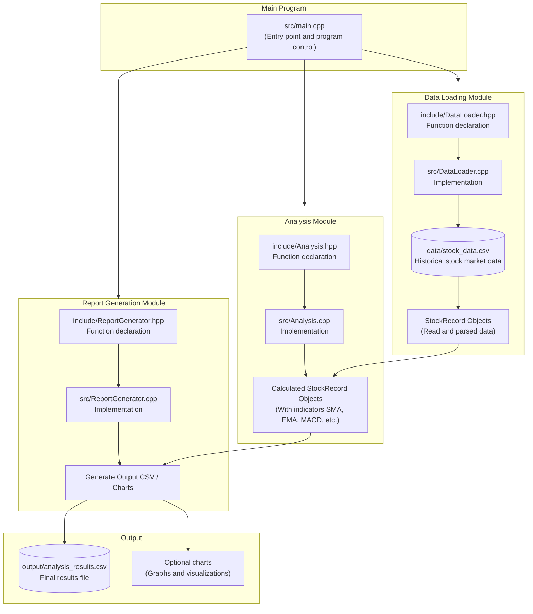
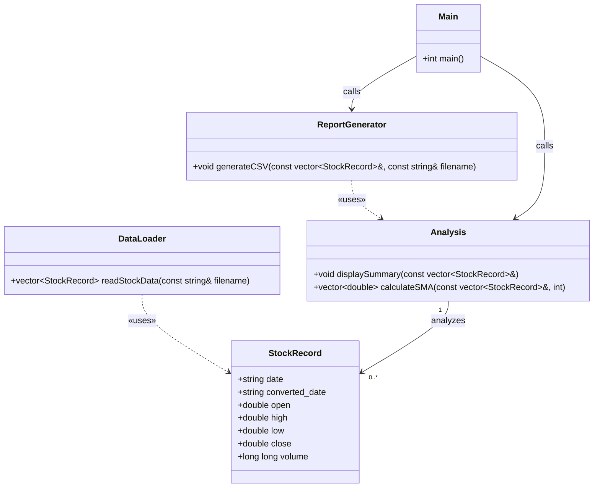
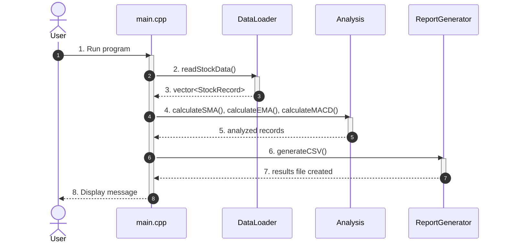
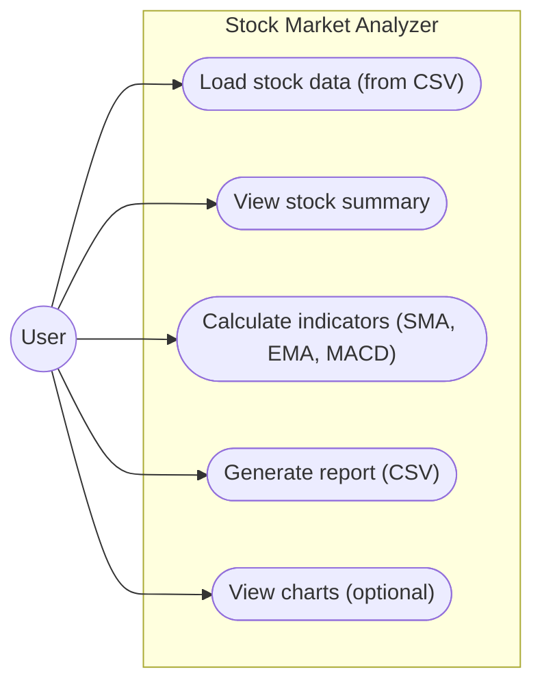
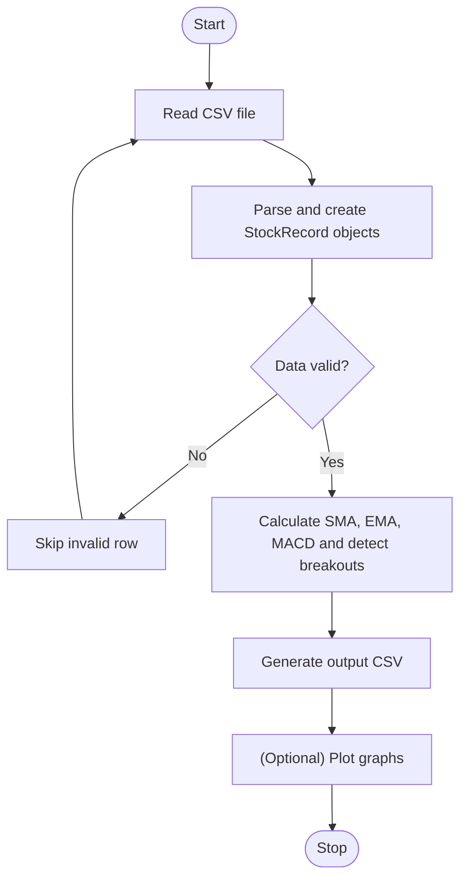

# Stock Market Time-Series Analyzer

A C++17 mini-project for analyzing historical stock market time-series data using STL, templates, SMA, EMA, MACD, and breakout detection.

---

## 1. Project Overview

The **Stock Market Time-Series Analyzer** is a mini-project developed using C++17 to analyze historical stock-market data. It processes stock price information stored in CSV files and applies technical analysis algorithms to identify trends and understand price movements.

The project aims to demonstrate how programming concepts, data structures, and financial analysis techniques can be combined to process and analyze stock-market data.

---

## 2. Objectives

- Read and process historical stock-market data from CSV files.
- Organize and validate stock price records.
- Calculate Simple Moving Average (SMA).
- Calculate Exponential Moving Average (EMA).
- Analyze price trends using technical indicators.
- Identify possible breakout patterns.
- Present analysis results through a user-friendly interface, where implemented.

---

## 3. Technologies Used

### Core Technologies
- **C++17** – Data processing and implementation of analysis algorithms.
- **STL** – Vectors, strings, and other standard library components.
- **CSV** – Storage and retrieval of historical stock data.

### Web Technologies
- **HTML** – Structure of the website.
- **CSS** – Styling and layout of the website.
- **JavaScript** – Frontend interaction and chart visualization.

---

## 4. Features

- CSV file loading and data processing.
- Stock price data validation.
- Simple Moving Average (SMA).
- Exponential Moving Average (EMA).
- MACD indicator calculation.
- Breakout detection.
- Graphical presentation of analysis results through the web dashboard.

---

## 5. System Architecture & UML Diagrams

### 5.1 System Architecture



### 5.2 UML Class DiagramCode

### 5.3 UML Sequence DiagramCode

### 5.4 UML Use Case DiagramCode

### 5.5 UML Activity DiagramCode

### 6. Project Structure
```text
stock-market-time-series-analyzer/
│
├── data/
│   └── stock_data.csv             # Historical OHLCV market dataset
│
├── include/
│   ├── DataLoader.hpp             # Header for CSV parsing logic
│   ├── Analysis.hpp               # Header for technical indicators
│   ├── ReportGenerator.hpp        # Header for CSV output generator
│   └── StockRecord.hpp            # StockRecord data structure
│
├── src/
│   ├── DataLoader.cpp             # CSV parsing implementation
│   ├── Analysis.cpp               # SMA, EMA, MACD calculations
│   └── ReportGenerator.cpp        # CSV exporting implementation
│
├── output/
│   └── analysis_results.csv       # Generated analytical results
│
├── main.cpp                       # Program entry point & execution flow
├── index.html                     # Frontend structure
├── app.js                         # Web interaction and chart logic
├── style.css                      # UI stylesheet
├── README.md                      # Project documentation
└── .gitignore
```
## 7. How It Works

1. Historical stock-market data is stored in a CSV file.
2. The program reads the CSV file.
3. The data is parsed and validated.
4. Closing prices are extracted for analysis.
5. Technical indicators are calculated.
6. The results are displayed or passed to the frontend, depending on the implemented integration.

## 8. Technical Indicators

### Simple Moving Average (SMA)

SMA calculates the average closing price over a selected number of periods.

**Formula:**

SMA = Sum of closing prices over N periods / N

### Exponential Moving Average (EMA)

EMA gives more importance to recent stock prices.

**Formula:**

EMA = (Current Price × Multiplier) + (Previous EMA × (1 − Multiplier))

Multiplier = 2 / (N + 1)

### MACD

MACD compares two exponential moving averages to analyze momentum.

**Formula:**

MACD = 12-period EMA − 26-period EMA

Signal Line = 9-period EMA of MACD

## 9. Dataset

The project uses historical stock-market data stored in CSV format.

Typical fields include:

- Date
- Open
- High
- Low
- Close
- Volume

## 10. How to Run

### Requirements

- C++ compiler supporting C++17
- GCC / G++
- CSV dataset

### Compile

```bash
g++ -std=c++17 main.cpp src/DataLoader.cpp src/Analysis.cpp src/ReportGenerator.cpp -Iinclude -o stock_analyzer
```

### Execute

```bash
./stock_analyzer
```

Make sure the CSV file is available at the path expected by the program.

## 11. Future Improvements

- Integrate a live stock-market data API.
- Add more technical indicators.
- Improve interactive charts and visualizations.
- Add support for multiple stocks and date ranges.
- Improve the website's data visualization and reporting features.

## 12. Team Members
Team members:
VARUNAVI.B(251112)
DIVYA SRI.P(251141)

**Course Code:** CS3104

## 13. Conclusion

The Stock Market Time-Series Analyzer demonstrates the use of C++ programming and financial analysis techniques to process historical stock-market data. It provides a foundation for understanding time-series data, calculating technical indicators, and presenting meaningful information for further analysis.
